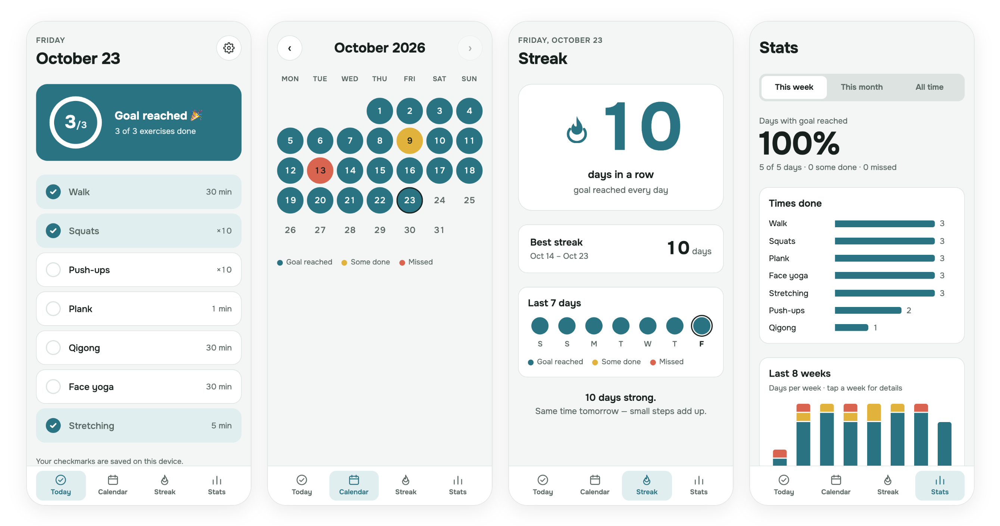

# My Workout Day

[](https://github.com/mayskii/moy-den-sporta/actions/workflows/test.yml)

A simple, free phone web app for daily exercise: check off what you did today, aim for at least 3 exercises a day, and see your progress on a color calendar.

**Live:** https://mayskii.github.io/moy-den-sporta/ (works best on a phone: install it to your home screen and it works offline)

<picture>
  <source media="(prefers-color-scheme: dark)" srcset="docs/screens-dark.png">
  
</picture>

<sub>Screens with demo data. The app has light and dark themes and follows your phone's setting.</sub>

## Why

Almost every workout app I found wanted a paid subscription. I wanted something simple and free that I could use every day and share with others. No sign-up, no ads, no subscription.

## What it does

- **Today:** your exercise list as a checklist, with a progress ring toward the daily goal
- **Calendar:** each day colored by how it went: goal reached, some done, or nothing
- **Streak:** current and best streak, and the last 7 days
- **Stats:** share of days with the goal reached, how often each exercise was done, the last 8 weeks
- **Settings:** change the daily goal, add, rename, reorder, remove and restore exercises
- **Backup:** save all your data to a file and restore it later
- **Installable and offline:** add it to your home screen and it opens like an app, even without internet
- Light and dark themes; calendar colors chosen to stay distinct for colorblind users

## Privacy

Your data stays only in your own browser (localStorage) and is never sent anywhere. The app loads nothing from other servers: even the font ([Onest](https://github.com/googlefonts/onest), SIL Open Font License) is included in `fonts/`. Because the data lives in the browser, use **Backup** before clearing site data or changing phones.

## How I built it with Claude

I built this app during Anthropic's AI Fluency course, using Claude Code for the code and Claude Design for one screen.

1. **Plan first.** Before any code, I planned the project with Claude. Its questions made me imagine real use, and that changed the main rule: not "finish the whole list every day," but "at least 3 exercises." I decided what stays with me (what the app does, judging it on my phone) and what Claude does (drafts, code, explanations).
2. **Small steps.** Today screen → calendar → stats → settings and backup → streak. One step at a time, each one a separate commit.
3. **Check after every step.** I tested each step on my phone and on a large screen, and asked Claude to explain each piece of code until I understood it. Claude's code looked right but had bugs: hidden tabs still showed, and the bottom of long tabs was cut off under the tab bar. I caught both by testing.
4. **Design, then build.** The Streak tab was first sketched in Claude Design, then built in Claude Code with the app's own colors so it works in both themes.

**What I learned:** the more clearly I describe what I want, including how I will test it, the less Claude has to guess. Checking the result is harder than describing the task, and every check makes the next description better. Some things did not go to plan: building it "in an hour" was unrealistic, and file backup didn't work inside a Claude artifact, so I moved the project to my own files and GitHub Pages.

## What's next

This is only the beginning. Next, I want to give the app to a few people, listen to what is confusing or missing, and improve it based on their feedback, keeping it free.

## Tech

Plain HTML, CSS and JavaScript with ES modules: no frameworks and no build step. Hosted on GitHub Pages.

```
index.html          the page
style.css           styles, light and dark theme
app.js              the interface: draws the tabs and reacts to taps
js/logic.js         day colors, goal history, streaks, stats, backup checks (no page, no storage)
js/dates.js         day keys like "2026-10-23", adding days, Monday of a week
js/storage.js       saving to localStorage
sw.js               service worker: offline copy of the app
tests/              tests for js/logic.js and js/dates.js
```

The logic gets the data and today's date as inputs instead of reading them itself, so the tests can check any situation: "today is Friday, the goal changed on Thursday, Tuesday was half done".

**Tests.** 46 tests with Node's built-in test runner (`node:test`), no test libraries. GitHub Actions runs them and ESLint on every push. Writing them found real bugs in backup restore: a hand-edited backup file could bring in goals as text (so the + button turned 3 into 31) or goals that were all invalid, which made the app crash on every open. The restore code now cleans such files.

**Accessibility.** Lighthouse gives 100, but it only looks at the first screen. So I also ran axe (the checker inside Lighthouse) on every tab and state in both themes, and went through the app with the keyboard only. That found two real problems:
- Contrast: some text was below 4.5:1 (white numbers on red calendar days, red "Remove" text, inactive period buttons). I darkened the grey text a little and made the numbers on red days dark, instead of darkening the red: a darker red would look like the teal "goal reached" to colorblind users.
- Keyboard focus was lost after almost every action: checking an exercise redraws the list, so the focused button disappeared and the next Tab started from the top. Now the focus stays on the same button, or moves to the next logical place ("Remove Walk" → "Restore Walk").

Buttons also tell screen readers what they belong to ("Move Walk up", not just "Move up"), and calendar days say the weekday, the date and how the day went.

**PWA.** `manifest.webmanifest` describes the app (name, icons, colors) so phones can install it. The service worker `sw.js` asks the network first, so all files always come from the same version, and keeps a copy of each file for when there is no internet.

**Lighthouse** (live site, mobile, October 2026): Performance 97–100 (varies between runs) · Accessibility 100 · Best Practices 100 · SEO 100. On a simulated mid-range phone with slow 4G, the main content appears in about 1.2 s.

### Run it locally

Browsers don't load modules from a file opened directly, so start a small server:

```bash
python3 -m http.server
```

Then open http://localhost:8000. To run the tests and ESLint (needs Node.js):

```bash
npm install
npm test
npm run lint
```
